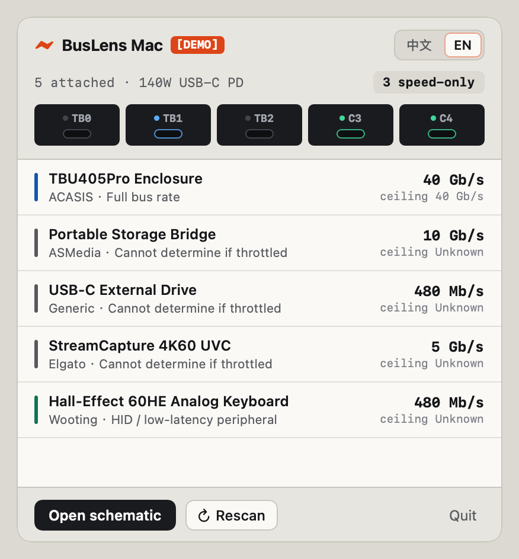

# BusLens Mac (`v0.2.0`)

**English** | **[简体中文](README.zh-CN.md)**

**Native macOS utility that lists attached Thunderbolt, USB4, and USB devices and their negotiated link speeds from `system_profiler` — with a headless `--json` CLI and live `中文 / EN` bilingual switching.**


> **`[DEMO]` Screenshot Notice:** Both screenshots on this page are rendered from `BusLensMonitor.preview()` synthetic demo data (`--export-screenshots`), **not** a live capture from a real Mac.

USB-C ports and cables look identical from the outside whether a link negotiates `40 Gb/s` (Thunderbolt 4 / USB4), `20 Gb/s`, `10 Gb/s`, `5 Gb/s`, `480 Mb/s`, or `12 Mb/s`. **BusLens Mac** consolidates `SPThunderboltDataType`, `SPUSBHostDataType` (plus legacy `SPUSBDataType` fallback), and `SPPowerDataType` into one read-only hardware bench window, menu bar popover, and scriptable CLI without requiring `sudo`.

## What It Does Today (`M0` / `v0.2.0`)

- **Per-Device Negotiated Link Speeds** — Reads each Thunderbolt / USB4 device's own upstream link speed (`receptacle_upstream_ambiguous_tag`, including daisy-chained devices) and each USB peripheral's `USBDeviceKeyLinkSpeed` so device rates are never overwritten by upstream host bus rates.
- **Honest Three-State Status Verdicts (No Name Guessing)** — `system_profiler` exposes negotiated link speed, not a peripheral's maximum hardware capability. BusLens Mac reports only three factual verdicts:
  1. **`Full bus rate`** — Negotiated speed meets a reported controller ceiling or runs at `>= 40 Gb/s` Thunderbolt / USB4 rate.
  2. **`HID / low-latency peripheral`** — Confirmed keyboard, mouse, receiver, audio, or Bluetooth device operating normally at USB 1.x / 2.0 (`<= 480 Mb/s`).
  3. **`Indeterminate`** — `"Negotiated at X; cannot determine if cable/hub-limited without device max capability."` (for example, a native `10 Gb/s` Samsung T7 and a `40 Gb/s` enclosure running on a `10 Gb/s` cable both report `10 Gb/s` in `system_profiler`, so M0 never guesses cable bottlenecks from product names).
- **Explicit vs Unknown Controller Ceilings & Built-in Hub Filtering** — Displays `Unknown` when `system_profiler` omits an explicit controller ceiling (never fabricated as `10 Gb/s` or `40 Gb/s`), and distinguishes Apple's internal root/companion hubs (`USBKeyHardwareType: Built-in`) from external USB hubs.
- **Headless CLI & `--json` Output** — Handles `--cli`, `--help`, `--version`, and `--export-screenshots` before AppKit / SwiftUI starts, exiting cleanly with `0` on success, `1` on runtime/input errors, and `2` on unknown subcommands or invalid flags.
- **Live `中文 / EN` Bilingual Switching & Identifier Redaction** — Switch languages live via the `中文 | EN` pill, `⇧⌘L`, or `--lang en|zh`, while device serial numbers and Thunderbolt UUIDs are scrubbed at parse time.

<p align="center">
  
</p>
<p align="center"><em><code>[DEMO]</code> Synthetic preview topology rendered from <code>BusLensMonitor.preview()</code>.</em></p>

## Verification Status & Hardware Matrix

Measured on **2026-11-14** on Apple Silicon Mac mini running **macOS 27.0.1 (`26A434`) arm64** (raw log in [`reports/m0-acceptance.txt`](reports/m0-acceptance.txt)):

| Capability / Schema | Verification Status | Evidence |
|---|---|---|
| `SPThunderboltDataType` + `SPUSBHostDataType` + `SPPowerDataType` (macOS 27.0.1 arm64) | **Verified on real hardware** | Scrubbed live capture (`Tests/BusLensMacTests/Fixtures/host_macmini_scrubbed.json`: `40 Gb/s` USB4 enclosure, `480 Mb/s` keyboard, `12 Mb/s` receiver) + 50 consecutive `--cli topology --json` runs (~0.25–0.36 s/run, 0 hangs, exit `0`). |
| Legacy `SPUSBDataType` schema (macOS 14–15) | **Unverified on real hardware (synthetic fixtures only)** | Tested via synthetic unit fixtures in `CollectorTests` (`Tests/BusLensMacCoreTests/CollectorTests.swift`). |
| Thunderbolt 5 (`80 Gb/s` / `120 Gb/s`) | **Unverified on real hardware (synthetic fixtures only)** | Speed parser tested with synthetic inputs only; not yet tested on Thunderbolt 5 Mac hardware. |

## Planned (Not in `v0.2.0` M0)

- **Planned (M1) — Per-Device Capability Probing via `ioreg`**: Read USB BOS / SuperSpeed capability descriptors and Thunderbolt link capability registers from `ioreg` to compare a device's hardware maximum rate against its negotiated link speed (and enable `--cli bottlenecks`).
- **Planned (M2) — Live IOKit Hot-Plug Stream**: Event-driven topology updates and historical link-retrain counters.

## Install (`v0.2.0`)

### Homebrew Cask

```bash
brew install --cask zxu756/tap/buslens-mac
```

### Build from Source (macOS 14.0+, Apple Silicon)

```bash
git clone https://github.com/zxu756/BusLensMac.git
cd BusLensMac
./Scripts/test.sh milestone 0
./Scripts/build-app.sh
open build/BusLensMac.app
```

To launch the GUI in a specific language (or inspect the synthetic `[DEMO]` topology in the window), pass `--lang en`, `--lang zh`, or `--demo` when invoking the app binary.

## CLI Usage

Every command below runs headlessly without launching a GUI window and is verified automatically by [`Scripts/acceptance/readme-commands.sh`](Scripts/acceptance/readme-commands.sh) (logged in [`reports/readme-commands.txt`](reports/readme-commands.txt)):

```bash
# Print live host bus and device negotiated speeds (English or Simplified Chinese)
build/BusLensMac.app/Contents/MacOS/BusLensMac --cli topology --lang en
build/BusLensMac.app/Contents/MacOS/BusLensMac --cli topology --lang zh

# Emit structured JSON topology output
build/BusLensMac.app/Contents/MacOS/BusLensMac --cli topology --json --lang en
build/BusLensMac.app/Contents/MacOS/BusLensMac --cli topology --json --lang zh

# Inspect a saved system_profiler -json file instead of querying the live host
build/BusLensMac.app/Contents/MacOS/BusLensMac --cli topology --input Tests/BusLensMacTests/Fixtures/host_macmini_scrubbed.json --lang en

# Explicitly inspect built-in synthetic [DEMO] topology
build/BusLensMac.app/Contents/MacOS/BusLensMac --cli topology --demo --lang en

# Export 2x Retina [DEMO] screenshots to a scratch directory
build/BusLensMac.app/Contents/MacOS/BusLensMac --export-screenshots .build/demo-shots --lang en
build/BusLensMac.app/Contents/MacOS/BusLensMac --export-screenshots .build/demo-shots --lang zh

# Show CLI usage and version
build/BusLensMac.app/Contents/MacOS/BusLensMac --help --lang en
build/BusLensMac.app/Contents/MacOS/BusLensMac --version
```

## Architecture & Spec

See [docs/SPEC.md](docs/SPEC.md).

## License

MIT
