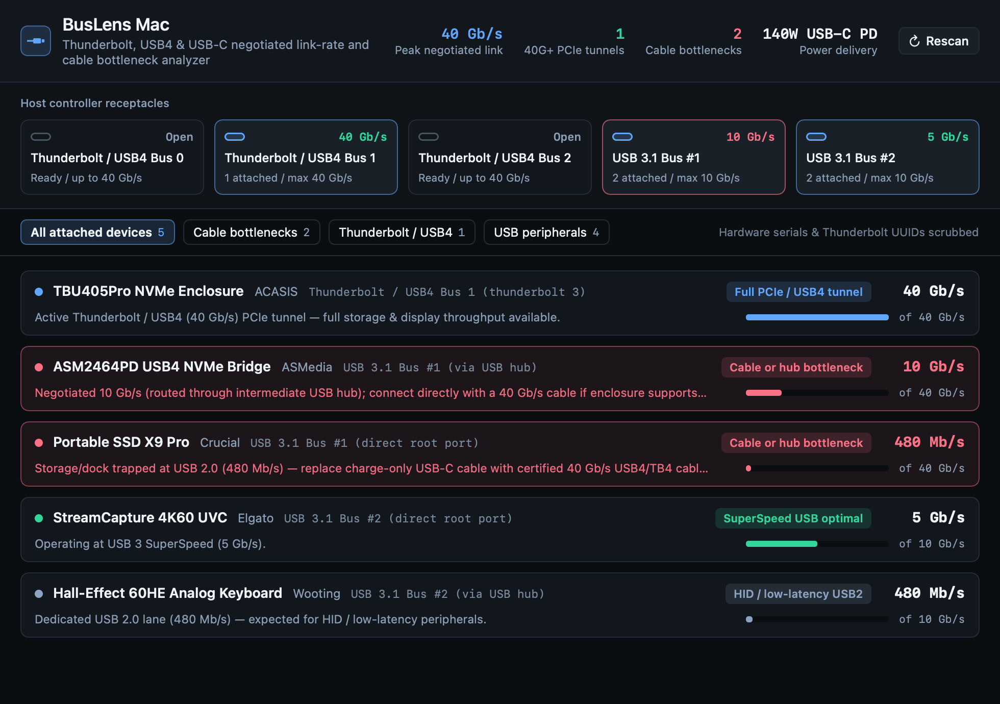

# BusLens Mac

**English** | **[简体中文](README.zh-CN.md)**

**Native macOS utility that lists attached Thunderbolt, USB4, and USB devices, maps them to physical ports, and compares negotiated link speeds against `ioreg` device capability descriptors — with a headless `--json` CLI and live `中文 / EN` bilingual switching.**



> **`[DEMO]` Screenshot Notice:** Both screenshots on this page are rendered from `BusLensMonitor.preview()` synthetic demo data (`--export-screenshots`), **not** a live capture from a real Mac.

USB-C ports and cables look identical from the outside whether a link negotiates `40 Gb/s` (Thunderbolt 4 / USB4), `20 Gb/s`, `10 Gb/s`, `5 Gb/s`, `480 Mb/s`, `12 Mb/s`, or `1.5 Mb/s`. **BusLens Mac** combines read-only `system_profiler` (`SPThunderboltDataType`, `SPUSBHostDataType`, `SPUSBDataType`, `SPPowerDataType`) and `ioreg` (`AppleUSBHostPort`, `IOThunderboltSwitch`) into one hardware bench window, menu bar popover, and scriptable CLI without requiring `sudo`.

## What It Does (`Unreleased (after v0.2.0)` — M0 & M1)

> **Release Note:** Published tag `v0.2.0` (`main`) predates the M0 honesty fixes and M1 `ioreg` capability diagnostics below. Pre-AppKit CLI exit handling, `--json`, `--input`, `--ioreg-input`, `--cli bottlenecks`, `--demo`, `--help`, `--version`, `./Scripts/test.sh`, physical port mapping, and descriptor-backed link verdicts below are **Unreleased (after v0.2.0)**.

- **Per-Device Negotiated Link Speeds & Physical Port Mapping** — Reads each Thunderbolt / USB4 device's own upstream link speed (`receptacle_upstream_ambiguous_tag`, including daisy-chained devices) and each USB peripheral's `USBDeviceKeyLinkSpeed` / `UsbLinkSpeed`. Maps `locationID` and Thunderbolt `Router ID` / `Socket ID` via `ioreg` `AppleUSBHostPort` (`UsbIOPort`) and `IOThunderboltPort` to physical receptacles (such as `Port-USB-C@2` and `Port-USB-C@6`), including cross-propagating USB 3.x companion ceilings onto USB 2.0 companion paths.
- **Descriptor-Backed Link Verdicts (Zero Product-Name Guessing)** — Never inspects product or vendor names. Compares negotiated rate against hardware capability descriptors read from `ioreg` (`bcdUSB`, `bDeviceClass`, `bInterfaceClass`, and `IOThunderboltPort` `Supported Link Speed` × `Supported Link Width`):
  1. **`Full bus rate`** — Negotiated speed meets an explicitly reported controller ceiling or runs at `>= 40 Gb/s` Thunderbolt / USB4 rate (without throttling below device max capability).
  2. **`Normal`** — Negotiated speed matches the peripheral's proven maximum capability (e.g. `bcdUSB = 0x0200` at `480 Mb/s`, `0x0300` at `5 Gb/s`, `0x0310` at `10 Gb/s`, or USB Billboard `bDeviceClass = 17` auxiliary endpoint).
  3. **`HID peripheral`** — Applied strictly when USB device or interface class is verified HID (`class == 3`) at `1.5 Mb/s` or `12 Mb/s` (`U14`: a `12 Mb/s` Mass Storage `class == 8` device is never mislabeled as a low-speed peripheral).
  4. **`Throttled`** — Hardware descriptors prove the device supports a higher tier than negotiated (e.g. USB 3.x device with BOS `bcdUSB = 0x0210` negotiated at `480 Mb/s` or `12 Mb/s`, or `40 Gb/s`-capable Thunderbolt switch negotiated at `20 Gb/s`), attributing the bottleneck segment to **`Port-limited`** (host port ceiling < device capability), **`Hub-limited`** (external USB Class-9 hub speed < device capability), or **`Cable-limited`** (host port and hubs support higher speed than negotiated).
  5. **`Indeterminate`** — Reported whenever hardware descriptors are absent (e.g. offline `--input` without `--ioreg-input`) or protocol-ambiguous (e.g. `bcdUSB = 0x0200` at `12 Mb/s` without `DeviceQualifier` or HID class `3`, or `bcdUSB = 0x0320` on xHCI without SuperSpeedPlus lane attributes).
- **Strict Class-9 Hub Container Filtering (`U13`) & Honest Unknowns** — Hides only Apple internal root/companion hubs (`Built-in` / `USBPortType` internal) and explicit USB Hub Class (`bDeviceClass == 9`) containers; composite docks (`bDeviceClass == 0`), Billboard docks (`bDeviceClass == 17`), and leaf drives containing `"hub"` remain visible. Unreported controller ceilings and missing power fields render as `Unknown` (`null` in JSON).
- **Headless CLI (`topology` & `bottlenecks`) & `--json` Output** — Exits before AppKit starts with `0` on success, `1` on runtime/input errors (including offline `--cli bottlenecks --input` without `--ioreg-input`), and `2` on unknown subcommands or invalid flags.
- **Live `中文 / EN` Bilingual Switching & Identifier Redaction** — Switch languages live via `中文 | EN`, `⇧⌘L`, or `--lang en|zh`, while serial numbers, UUIDs, UIDs, and ContainerIDs from `system_profiler` and `ioreg` are scrubbed automatically.

<p align="center">
  
</p>
<p align="center"><em><code>[DEMO]</code> Synthetic preview topology rendered from <code>BusLensMonitor.preview()</code>.</em></p>

## Verification Status & Hardware Matrix

Measured on **2026-11-15** on Apple Silicon Mac mini running **macOS 27.0.1 (`26A434`) arm64** (raw logs in [`reports/m0-acceptance.txt`](reports/m0-acceptance.txt) and [`reports/m1-acceptance.txt`](reports/m1-acceptance.txt)):

| Capability / Schema | Verification Status | Evidence |
|---|---|---|
| `SPThunderboltDataType` + `SPUSBHostDataType` + `SPPowerDataType` + `ioreg` (`AppleUSBHostPort` / `IOThunderboltSwitch`) on macOS 27.0.1 arm64 | **Verified on real hardware** | Scrubbed live captures (`host_macmini_scrubbed.json` and paired `host_macmini_20261115_sp_scrubbed.json` + `host_macmini_20261115_ioreg_scrubbed.plist`), item-by-item differential check (`m1-differential.sh`), and 50 consecutive `--cli topology --json` runs (< 0.9 s/run, exit `0`, 0 identifier leaks). |
| Real-hardware charging-only USB-C cable & external USB 2.0 hub throttling captures | **Unverified on real hardware (synthetic fixtures only)** | Requires manual cable/hub swapping; evaluated across 16+ synthetic `system_profiler` + `ioreg` scenarios in `DiagnoserTests` and `m1-differential.sh`. |
| Legacy `SPUSBDataType` schema (macOS 14–15) | **Unverified on real hardware (synthetic fixtures only)** | Tested via synthetic unit fixtures in `CollectorTests` (`Tests/BusLensMacCoreTests/CollectorTests.swift`). |
| Thunderbolt 5 (`80 Gb/s` / `120 Gb/s`) | **Unverified on real hardware (synthetic fixtures only)** | Speed and link-mask parsers tested with synthetic inputs only; not yet tested on Thunderbolt 5 Mac hardware. |

## Planned (M2)

- **Planned (M2) — Short Sequential Read Probe with `CrystalDiskMarkMac`**: Pair negotiated bus ceiling with actual disk throughput to separate link bottlenecks from slow media.
- **Planned (M2) — Live IOKit Hot-Plug Stream & Per-Device Speed History**: Record historical negotiated speeds per peripheral to alert when a previously `40 Gb/s` enclosure reconnects at `480 Mb/s`.
- **Planned (M2) — USB-C E-Marker Cable Capability Inspection**: Investigate whether user-space `ioreg` exposes cable e-marker capability without `sudo`.

## Install

### Homebrew Cask (`v0.2.0` published release)

```bash
brew install --cask zxu756/tap/buslens-mac
```

### Build from Source (macOS 14.0+, Apple Silicon)

> `./Scripts/test.sh` is **Unreleased (after v0.2.0)**.

```bash
git clone https://github.com/zxu756/BusLensMac.git
cd BusLensMac
./Scripts/test.sh scope Diagnoser Collector CLI
./Scripts/test.sh milestone 0
./Scripts/test.sh milestone 1
./Scripts/build-app.sh
open build/BusLensMac.app
```

To launch the GUI in a specific language (or inspect the synthetic `[DEMO]` topology in the window, `Unreleased (after v0.2.0)`), pass `--lang en`, `--lang zh`, or `--demo` when invoking the app binary.

## CLI Usage

> **Availability:** `--cli topology`, `--lang en|zh`, and `--export-screenshots <dir>` exist in `v0.2.0`; `--cli bottlenecks`, `--json`, `--input <path>`, `--ioreg-input <path>`, `--demo`, `--help` (`-h`), `--version` (`-v`), and pre-AppKit exit codes (`0` / `1` / `2`) are **Unreleased (after v0.2.0)**.

Every local CLI command below runs headlessly without launching a GUI window and is verified automatically by [`Scripts/acceptance/readme-commands.sh`](Scripts/acceptance/readme-commands.sh) (logged in [`reports/readme-commands.txt`](reports/readme-commands.txt)):

```bash
# Print live host bus, physical port, and device negotiated speeds (English or Simplified Chinese)
build/BusLensMac.app/Contents/MacOS/BusLensMac --cli topology --lang en
build/BusLensMac.app/Contents/MacOS/BusLensMac --cli topology --lang zh

# Emit structured JSON topology output — Unreleased (after v0.2.0)
build/BusLensMac.app/Contents/MacOS/BusLensMac --cli topology --json --lang en
build/BusLensMac.app/Contents/MacOS/BusLensMac --cli topology --json --lang zh

# List only links proven throttled below their ioreg capability descriptor — Unreleased (after v0.2.0)
build/BusLensMac.app/Contents/MacOS/BusLensMac --cli bottlenecks --lang en
build/BusLensMac.app/Contents/MacOS/BusLensMac --cli bottlenecks --lang zh

# Inspect a saved system_profiler + ioreg capture pair — Unreleased (after v0.2.0)
build/BusLensMac.app/Contents/MacOS/BusLensMac --cli topology --input Tests/BusLensMacTests/Fixtures/host_macmini_20261115_sp_scrubbed.json --ioreg-input Tests/BusLensMacTests/Fixtures/host_macmini_20261115_ioreg_scrubbed.plist --lang en
build/BusLensMac.app/Contents/MacOS/BusLensMac --cli topology --input Tests/BusLensMacTests/Fixtures/host_macmini_20261115_sp_scrubbed.json --ioreg-input Tests/BusLensMacTests/Fixtures/host_macmini_20261115_ioreg_scrubbed.plist --lang zh

# Inspect a saved system_profiler -json file without ioreg descriptors — Unreleased (after v0.2.0)
build/BusLensMac.app/Contents/MacOS/BusLensMac --cli topology --input Tests/BusLensMacTests/Fixtures/host_macmini_scrubbed.json --lang en
build/BusLensMac.app/Contents/MacOS/BusLensMac --cli topology --input Tests/BusLensMacTests/Fixtures/host_macmini_scrubbed.json --lang zh

# Explicitly inspect built-in synthetic [DEMO] topology — Unreleased (after v0.2.0)
build/BusLensMac.app/Contents/MacOS/BusLensMac --cli topology --demo --lang en
build/BusLensMac.app/Contents/MacOS/BusLensMac --cli topology --demo --lang zh

# Export 2x Retina [DEMO] screenshots to a scratch directory
build/BusLensMac.app/Contents/MacOS/BusLensMac --export-screenshots .build/demo-shots --lang en
build/BusLensMac.app/Contents/MacOS/BusLensMac --export-screenshots .build/demo-shots --lang zh

# Show CLI usage and version — Unreleased (after v0.2.0)
build/BusLensMac.app/Contents/MacOS/BusLensMac --help --lang en
build/BusLensMac.app/Contents/MacOS/BusLensMac --help --lang zh
build/BusLensMac.app/Contents/MacOS/BusLensMac --version
```

## Architecture & Spec

See [docs/SPEC.md](docs/SPEC.md).

## License

MIT
