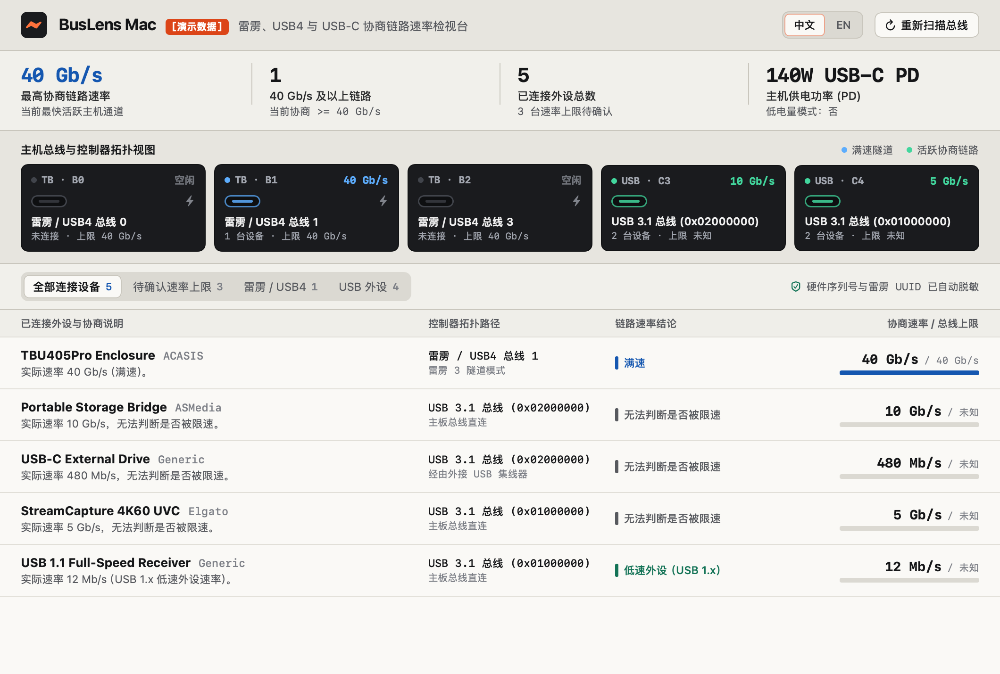

# BusLens Mac

**[English](README.md)** | **简体中文**

**原生 macOS 雷雳 (Thunderbolt)、USB4 与 USB 设备协商速率检视工具，直接读取 `system_profiler` 拓扑并提供无界面 `--json` 命令行与 `中文 / EN` 实时切换。**



> **`[演示数据]` 截图说明：** 本页两张界面截图均由 `BusLensMonitor.preview()` 内置合成演示拓扑（`--export-screenshots`）渲染生成，**并非**真机实时采集画面。

不同规格的 USB-C 接口与线材在外观上几乎一致，但实际协商出的链路速率可能是 `40 Gb/s`（雷雳 4 / USB4）、`20 Gb/s`、`10 Gb/s`、`5 Gb/s`、`480 Mb/s`、`12 Mb/s` 或 `1.5 Mb/s`。**BusLens Mac** 将 `SPThunderboltDataType`、`SPUSBHostDataType`（含旧版 `SPUSBDataType` 回退解析）与 `SPPowerDataType` 整合为统一的只读桌面工作台窗口、菜单栏弹窗与可脚本化 CLI，全程无需 `sudo` 提权。

## 当前功能（`v0.3.0 起` — M0）

> **版本说明：** 此前的 `v0.2.0` 早于下方 M0 诚实化修订。AppKit 启动前 CLI 退出处理、`--json`、`--input`、`--demo`、`--help`、`--version`、`./Scripts/test.sh` 以及下述不依赖产品名猜测的三态结论均自 **v0.3.0 起** 提供。

- **逐设备真实协商速率解析** — 优先读取每个雷雳 / USB4 外设自身的 `receptacle_upstream_ambiguous_tag` 上行协商速率（含菊花链下级设备）及 USB 外设的 `USBDeviceKeyLinkSpeed`，不会用上游主控总线的 `40 Gb/s` 覆盖下挂设备的真实速率。
- **诚实的三态速率结论（不看设备名猜测）** — `system_profiler` 仅提供“当前协商速率”，不包含外设自身的硬件最高支持速率或 USB 接口设备类。M0 完全不检查产品名或厂商字符串，仅输出三种基于速率事实的结论：
  1. **`满速` (`Full bus rate`)** — 当前协商速率达到该总线显式报告的控制器上限，或运行在 `>= 40 Gb/s` 雷雳 / USB4 速率。
  2. **`低速外设（USB 1.x）` (`Low-speed peripheral`)** — 协商速率为 `1.5 Mb/s` 或 `12 Mb/s`（USB 1.x，`<= 0.0125 Gbps`）的链路，仅依据链路速率判定。
  3. **`无法判断是否被限速` (`Indeterminate`)** — 输出 `“实际速率 X，无法判断是否被限速。”`。所有低于显式总线上限的 `480 Mb/s`（USB 2.0）与 `5 Gb/s` / `10 Gb/s` / `20 Gb/s` 链路均标为 `无法判断是否被限速`，因为 `system_profiler` 不提供设备自身最高支持速率与设备类描述符（排在 M1 通过 `ioreg` 读取）。
- **未知上限、结构化集线器识别与供电状态诚实展示** — 当 `system_profiler` 未在该总线上提供显式速率上限时显示 `未知`（不硬编码为 `10 Gb/s` 或 `40 Gb/s`，也不从同主机其他总线复制上限）；当 `SPPowerDataType` / `pmset` 未提供供电来源或低电量模式时显示 `未知`（JSON 为 `null`），不默认写成交流电源或关闭；通过 `USBKeyHardwareType: Built-in` / `Built-in_Device: Yes` 过滤 Apple 主板内置集线器，并仅凭下级 `_items` 结构或显式 USB 集线器类（`0x09`）识别外接集线器容器，从不根据名称包含 `"hub"` 隐藏设备。
- **无界面 CLI 与 `--json` 结构化输出（`v0.3.0 起`）** — 在 AppKit / SwiftUI 启动前直接处理 `--cli`、`--help`、`--version` 与 `--export-screenshots` 并立即退出：成功返回 `0`，运行或输入错误返回 `1`，未知子命令或非法参数返回 `2`。
- **应用内 `中文 / EN` 实时切换与标识符脱敏** — 支持窗口与菜单栏顶部的 `中文 | EN` 胶囊按钮、快捷键 `⇧⌘L` 及命令行 `--lang zh|en`；解析阶段自动脱敏外设序列号与雷雳 UUID。

<p align="center">
  
</p>
<p align="center"><em><code>[演示数据]</code> 由 <code>BusLensMonitor.preview()</code> 渲染的内置合成演示拓扑。</em></p>

## 真机验证状态与硬件兼容矩阵

实测日期：**2026-11-14**，测试平台为搭载 **macOS 27.0.1 (`26A434`) arm64** 的 Apple Silicon Mac mini（原始验收日志见 [`reports/m0-acceptance.txt`](reports/m0-acceptance.txt)）：

| 能力 / 数据结构 | 验证状态 | 验证依据 |
|---|---|---|
| `SPThunderboltDataType` + `SPUSBHostDataType` + `SPPowerDataType`（macOS 27.0.1 arm64） | **已在真机验证** | 脱敏真机快照（`Tests/BusLensMacTests/Fixtures/host_macmini_scrubbed.json`：`40 Gb/s` USB4 硬盘盒、`480 Mb/s` USB 2.0 外设、`12 Mb/s` USB 1.x 接收器）+ 连续 50 次 `--cli topology --json` 实测（单次 `< 0.9` 秒，0 卡死，退出码 `0`）。 |
| 旧版 `SPUSBDataType` 结构（macOS 14–15） | **尚未在真机上验证（仅合成样本测试）** | 仅通过 `CollectorTests`（`Tests/BusLensMacCoreTests/CollectorTests.swift`）中的合成 JSON 样本测试。 |
| 雷雳 5 / Thunderbolt 5（`80 Gb/s` / `120 Gb/s`） | **尚未在真机上验证（仅合成样本测试）** | 仅通过合成速率字符串测试，尚未在雷雳 5 真机硬件上实测。 |

## 计划中功能（不在 M0 范围内）

- **计划中（M1）— 基于 `ioreg` 的设备硬件能力与设备类描述符读取**：从 `ioreg` 读取 USB BOS / SuperSpeed 速率能力描述符、USB 设备类及雷雳链路能力寄存器，将设备自身最高支持速率与当前协商速率交叉比对（并开放 `--cli bottlenecks`）。
- **计划中（M2）— IOKit 热插拔实时事件流**：事件驱动的端口插拔监听与链路重训练计数。

## 安装方式

### Homebrew Cask 安装（`v0.3.0` 版本）

```bash
brew install --cask zxu756/tap/buslens-mac
```

### 从源码构建（macOS 14.0+，Apple Silicon）

> `./Scripts/test.sh` 自 **v0.3.0 起** 提供。

```bash
git clone https://github.com/zxu756/BusLensMac.git
cd BusLensMac
./Scripts/test.sh scope Diagnoser Collector CLI
./Scripts/test.sh milestone 0
./Scripts/build-app.sh
open build/BusLensMac.app
```

如需以指定语言启动图形界面（或在窗口中查看带 `[演示数据]` 标记的合成拓扑，`v0.3.0 起`），可在直接调用二进制时传入 `--lang zh`、`--lang en` 或 `--demo`。

## 命令行用法

> **版本范围：** `--cli topology`、`--lang zh|en` 与 `--export-screenshots <目录>` 已在 `v0.2.0` 提供；`--json`、`--input <路径>`、`--demo`、`--help`（`-h`）、`--version`（`-v`）及 AppKit 启动前退出码契约（`0` / `1` / `2`）自 **v0.3.0 起** 提供。

以下每条本地命令均以无界面模式直接运行并退出，由 [`Scripts/acceptance/readme-commands.sh`](Scripts/acceptance/readme-commands.sh) 自动逐条回放校验（输出记录见 [`reports/readme-commands.txt`](reports/readme-commands.txt)）：

```bash
# 打印当前主机总线与外设协商速率拓扑（英文或简体中文）
build/BusLensMac.app/Contents/MacOS/BusLensMac --cli topology --lang en
build/BusLensMac.app/Contents/MacOS/BusLensMac --cli topology --lang zh

# 输出结构化 JSON 拓扑数据 — v0.3.0 起
build/BusLensMac.app/Contents/MacOS/BusLensMac --cli topology --json --lang en
build/BusLensMac.app/Contents/MacOS/BusLensMac --cli topology --json --lang zh

# 解析已保存的 system_profiler -json 文件（替代实时采集） — v0.3.0 起
build/BusLensMac.app/Contents/MacOS/BusLensMac --cli topology --input Tests/BusLensMacTests/Fixtures/host_macmini_scrubbed.json --lang en
build/BusLensMac.app/Contents/MacOS/BusLensMac --cli topology --input Tests/BusLensMacTests/Fixtures/host_macmini_scrubbed.json --lang zh

# 显式查看内置合成 [演示数据] 拓扑 — v0.3.0 起
build/BusLensMac.app/Contents/MacOS/BusLensMac --cli topology --demo --lang en
build/BusLensMac.app/Contents/MacOS/BusLensMac --cli topology --demo --lang zh

# 导出 2x Retina [演示数据] 截图至临时目录
build/BusLensMac.app/Contents/MacOS/BusLensMac --export-screenshots .build/demo-shots --lang en
build/BusLensMac.app/Contents/MacOS/BusLensMac --export-screenshots .build/demo-shots --lang zh

# 查看命令行帮助与版本号 — v0.3.0 起
build/BusLensMac.app/Contents/MacOS/BusLensMac --help --lang en
build/BusLensMac.app/Contents/MacOS/BusLensMac --help --lang zh
build/BusLensMac.app/Contents/MacOS/BusLensMac --version
```

## 架构与技术规范

详见 [docs/SPEC.md](docs/SPEC.md)。

## 开源协议

MIT
