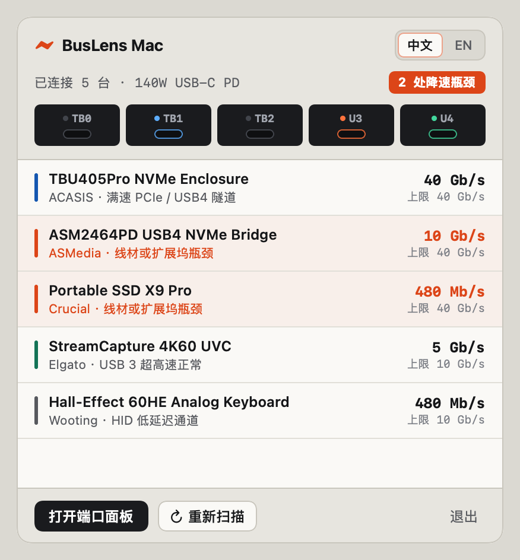

# BusLens Mac

**[English](README.md)** | **简体中文**

**原生 macOS 雷雳 (Thunderbolt)、USB4 与 USB 设备检视工具：对照 `system_profiler` 与 `ioreg` 映射物理端口、读取设备能力描述符并核验实际协商速率，提供无界面 `--json` 命令行与 `中文 / EN` 实时切换。**


> **`[演示数据]` 截图说明：** 本页两张界面截图均由 `BusLensMonitor.preview()` 内置合成演示拓扑（`--export-screenshots`）渲染生成，**并非**真机实时采集画面。

不同规格的 USB-C 接口与线材在外观上几乎一致，但实际协商出的链路速率可能是 `40 Gb/s`（雷雳 4 / USB4）、`20 Gb/s`、`10 Gb/s`、`5 Gb/s`、`480 Mb/s`、`12 Mb/s` 或 `1.5 Mb/s`。**BusLens Mac** 将只读 `system_profiler`（`SPThunderboltDataType`、`SPUSBHostDataType`、`SPUSBDataType`、`SPPowerDataType`）与 `ioreg`（`AppleUSBHostPort`、`IOThunderboltSwitch`）整合为桌面工作台窗口、菜单栏弹窗与可脚本化 CLI，全程无需 `sudo` 提权。

## 当前功能（`未发布（v0.2.0 之后）` — M0 与 M1）

> **版本说明：** 已发布的 `v0.2.0`（`main`）早于下方 M0 诚实化修订与 M1 `ioreg` 硬件能力诊断。AppKit 启动前 CLI 退出处理、`--json`、`--input`、`--ioreg-input`、`--cli bottlenecks`、`--demo`、`--help`、`--version`、`./Scripts/test.sh`、物理端口映射及基于描述符的速率结论均为 **未发布（v0.2.0 之后）**。

- **逐设备协商速率解析与物理端口映射** — 优先读取每个雷雳 / USB4 外设自身的 `receptacle_upstream_ambiguous_tag` 上行协商速率（含菊花链下级设备）及 USB 外设的 `USBDeviceKeyLinkSpeed` / `UsbLinkSpeed`；结合 `ioreg` `AppleUSBHostPort`（`UsbIOPort`）与 `IOThunderboltPort` 将 `locationID` 和雷雳 `Router ID` / `Socket ID` 映射至机身物理端口（如 `Port-USB-C@2`、`Port-USB-C@6`），读不到 `UsbIOPort` 或读不到端口上限时一律显示 `未知`，不拼接标签、不给默认值。
- **基于硬件描述符的速率结论（不看设备名猜测，推断结论显式标 `推断`）** — 完全不检查产品名或厂商字符串，仅将当前协商速率与 `ioreg` 暴露的硬件描述符（`bcdUSB`、`bDeviceClass`、`bInterfaceClass` 及 `IOThunderboltPort` `Supported Link Speed` × `Supported Link Width`）比对；凡靠 `bcdUSB` 推断得出的结论在命令行、JSON 与图形界面输出中均带 **`推断`** 标记：
  1. **`满速` (`Full bus rate`)** — 当前协商速率达到该总线显式报告的控制器上限，或运行在 `>= 40 Gb/s` 雷雳 / USB4 速率且未低于设备自身上限。
  2. **`正常` / `正常（推断）` (`Normal` / `Normal (inferred)`)** — 当前协商速率与显式硬件能力一致（如扩展坞 `bDeviceClass = 17` USB Billboard 辅助控制端点），或按 `bcdUSB` 推断已达对应协议上限（`bcdUSB = 0x0200` 跑在 `480 Mb/s`、`0x0300` 跑在 `5 Gb/s`、`0x0310` 跑在 `10 Gb/s`）。
  3. **`HID / 低速外设` (`HID peripheral`)** — 仅在 USB 设备类或接口类明确为 HID（`class == 3`）且运行在 `1.5 Mb/s` 或 `12 Mb/s` 时标注（`U14`：大容量存储 `class == 8` 设备即使跑在 `12 Mb/s` 也绝不误标为低速外设）。
  4. **`被限速` / `被限速（推断）` (`Throttled` / `Throttled (inferred)`)** — 硬件描述符表明设备支持更高档位（例如显式支持 `40 Gb/s` 的雷雳交换芯片协商在 `20 Gb/s`，或按 `bcdUSB = 0x0210` / `>= 0x0300` 推断支持 SuperSpeed 的设备跑在 `480 Mb/s` 或 `12 Mb/s`），并按已知上限归因：**`端口限速`**（机身端口显式上限低于设备能力）、**`集线器限速`**（外接 USB Class-9 集线器速率低于设备能力）、**`线缆限速`**（机身端口与集线器显式上限均高于协商速率），端口上限未知时诚实输出 **`无法判断是线还是口`**。
  5. **`无法判断是否被限速` (`Indeterminate`)** — 当缺少 `ioreg` 描述符（如离线 `--input` 未提供 `--ioreg-input`）或协议字段本身存在歧义（如 `bcdUSB = 0x0200` 在 `12 Mb/s` 下非 HID 类 `3`，或 `bcdUSB = 0x0320` 在 `5 Gb/s` / `10 Gb/s` 下缺少 SuperSpeedPlus 子链路属性）时诚实输出无法判断。
- **严格按 USB Class 9 过滤集线器容器（`U13`）与未知项诚实展示** — 仅隐藏 Apple 主板内置根/伴生集线器（`Built-in` / `USBPortType` 内部端口）及显式 USB 集线器类（`bDeviceClass == 9`）容器；复合功能扩展坞（`bDeviceClass == 0`）、Billboard 扩展坞（`bDeviceClass == 17`）及名称包含 `"hub"` 的终端硬盘均完整保留。未报告的总线上限与缺失的供电字段一律显示 `未知`（JSON 为 `null`）。
- **无界面 CLI（`topology` 与 `bottlenecks`）及 `--json` 输出** — 在 AppKit 启动前处理并退出：成功返回 `0`，运行或输入错误（含离线 `--cli bottlenecks --input` 未配对 `--ioreg-input`）返回 `1`，未知子命令或非法参数返回 `2`。
- **应用内 `中文 / EN` 实时切换与标识符脱敏** — 支持 `中文 | EN` 胶囊按钮、快捷键 `⇧⌘L` 与命令行 `--lang zh|en`；自动脱敏 `system_profiler` 与 `ioreg` 中的序列号、UUID、UID 与 ContainerID。

<p align="center">
  
</p>
<p align="center"><em><code>[演示数据]</code> 由 <code>BusLensMonitor.preview()</code> 渲染的内置合成演示拓扑。</em></p>

## 真机验证状态与硬件兼容矩阵

实测日期：**2026-11-15**，测试平台为搭载 **macOS 27.0.1 (`26A434`) arm64** 的 Apple Silicon Mac mini（原始验收日志见 [`reports/m0-acceptance.txt`](reports/m0-acceptance.txt) 与 [`reports/m1-acceptance.txt`](reports/m1-acceptance.txt)）：

| 能力 / 数据结构 | 验证状态 | 验证依据 |
|---|---|---|
| 1 台机器（Apple Silicon Mac mini，macOS 27.0.1 arm64）、3 台外接设备（`40 Gb/s`、`480 Mb/s`、`12 Mb/s`）的外设枚举数量与协商速率读取（`SPThunderboltDataType` + `SPUSBHostDataType` + `ioreg`） | **已在真机验证** | **仅核对了设备数（3 台）与协商速率**（`40 Gb/s`、`480 Mb/s`、`12 Mb/s`，本机 0 台被限速设备），对照脱敏真机快照（`host_macmini_scrubbed.json` 及配对的 `host_macmini_20261115_sp_scrubbed.json` + `host_macmini_20261115_ioreg_scrubbed.plist`）、同源 `ioreg` 对照脚本（`m1-differential.sh`）及连续 50 次 `--cli topology --json` 实测（单次 `< 0.9` 秒，退出码 `0`，0 标识符泄漏）。 |
| 限速判断与瓶颈段归因（`被限速` / `bcdUSB` 推断结论、充电线降速与外接 USB 2.0 集线器限速） | **未在真机验证（尚未在真机上验证（仅合成样本测试））** | 本机 3 台设备无一台被限速，且未做人工换线/换集线器实采；限速判断与靠 `bcdUSB` 推断出的结论（输出带 `推断` 标记）仅在 `DiagnoserTests` 与 `m1-differential.sh` 的合成样本上测试。 |
| 旧版 `SPUSBDataType` 结构（macOS 14–15） | **尚未在真机上验证（仅合成样本测试）** | 仅通过 `CollectorTests`（`Tests/BusLensMacCoreTests/CollectorTests.swift`）中的合成 JSON 样本测试。 |
| 保留的旧格式与电源字符串表键（`location_id`、`vendor_id`、`Built-in_Device`、`device_speed`、`serial_num`、`sppower_ac_charger_watts`） | **尚未在真机上验证（没有在作者的机器上验证）** | 键名来自旧格式的公开样本（`location_id`、`vendor_id`、`device_speed`、`serial_num`；其中 `Built-in_Device` 来自公开 XML 样本，JSON 下的键名未确认）或系统自带的字符串表（`sppower_ac_charger_watts` 来自本机 `SPPowerReporter.spreporter` 字符串表，仅在带电源适配器信息的机型上输出），没有在作者的机器上验证。 |
| 雷雳 5 / Thunderbolt 5（`80 Gb/s` / `120 Gb/s`） | **尚未在真机上验证（仅合成样本测试）** | 仅通过合成速率与链路位掩码测试，尚未在雷雳 5 真机硬件上实测。 |

## 计划中功能（M2）

- **计划中（M2）— 联动 `CrystalDiskMarkMac` 短时顺序读测速**：将链路协商上限与外接盘实测吞吐对照，区分链路受限与盘体本身偏慢。
- **计划中（M2）— IOKit 热插拔实时事件流与设备历史速率对比**：记录同一外设历次接入协商速率，发现速率回退时主动提示。
- **计划中（M2）— USB-C E-Marker 线缆芯片能力读取**：排查无 `sudo` 用户态能否从 `ioreg` 直接读取线缆芯片标称速率。

## 安装方式

### Homebrew Cask 安装（已发布 `v0.2.0`）

```bash
brew install --cask zxu756/tap/buslens-mac
```

### 从源码构建（macOS 14.0+，Apple Silicon）

> `./Scripts/test.sh` 为 **未发布（v0.2.0 之后）**。

```bash
git clone https://github.com/zxu756/BusLensMac.git
cd BusLensMac
./Scripts/test.sh scope Diagnoser Collector CLI
./Scripts/test.sh milestone 0
./Scripts/test.sh milestone 1
./Scripts/build-app.sh
open build/BusLensMac.app
```

如需以指定语言启动图形界面（或在窗口中查看带 `[演示数据]` 标记的合成拓扑，`未发布（v0.2.0 之后）`），可在直接调用二进制时传入 `--lang zh`、`--lang en` 或 `--demo`。

## 命令行用法

> **版本范围：** `--cli topology`、`--lang zh|en` 与 `--export-screenshots <目录>` 已在 `v0.2.0` 提供；`--cli bottlenecks`、`--json`、`--input <路径>`、`--ioreg-input <路径>`、`--demo`、`--help`（`-h`）、`--version`（`-v`）及 AppKit 启动前退出码契约（`0` / `1` / `2`）为 **未发布（v0.2.0 之后）**。

以下每条本地命令均以无界面模式直接运行并退出，由 [`Scripts/acceptance/readme-commands.sh`](Scripts/acceptance/readme-commands.sh) 自动逐条回放校验（输出记录见 [`reports/readme-commands.txt`](reports/readme-commands.txt)）：

```bash
# 打印当前主机总线、物理端口与外设协商速率拓扑（英文或简体中文）
build/BusLensMac.app/Contents/MacOS/BusLensMac --cli topology --lang en
build/BusLensMac.app/Contents/MacOS/BusLensMac --cli topology --lang zh

# 输出结构化 JSON 拓扑数据 — 未发布（v0.2.0 之后）
build/BusLensMac.app/Contents/MacOS/BusLensMac --cli topology --json --lang en
build/BusLensMac.app/Contents/MacOS/BusLensMac --cli topology --json --lang zh

# 仅列出根据 ioreg 设备能力描述符判定为被限速的链路 — 未发布（v0.2.0 之后）
build/BusLensMac.app/Contents/MacOS/BusLensMac --cli bottlenecks --lang en
build/BusLensMac.app/Contents/MacOS/BusLensMac --cli bottlenecks --lang zh

# 解析已保存的 system_profiler + ioreg 配对样本 — 未发布（v0.2.0 之后）
build/BusLensMac.app/Contents/MacOS/BusLensMac --cli topology --input Tests/BusLensMacTests/Fixtures/host_macmini_20261115_sp_scrubbed.json --ioreg-input Tests/BusLensMacTests/Fixtures/host_macmini_20261115_ioreg_scrubbed.plist --lang en
build/BusLensMac.app/Contents/MacOS/BusLensMac --cli topology --input Tests/BusLensMacTests/Fixtures/host_macmini_20261115_sp_scrubbed.json --ioreg-input Tests/BusLensMacTests/Fixtures/host_macmini_20261115_ioreg_scrubbed.plist --lang zh

# 解析仅包含 system_profiler -json（不含 ioreg 描述符）的样本 — 未发布（v0.2.0 之后）
build/BusLensMac.app/Contents/MacOS/BusLensMac --cli topology --input Tests/BusLensMacTests/Fixtures/host_macmini_scrubbed.json --lang en
build/BusLensMac.app/Contents/MacOS/BusLensMac --cli topology --input Tests/BusLensMacTests/Fixtures/host_macmini_scrubbed.json --lang zh

# 显式查看内置合成 [演示数据] 拓扑 — 未发布（v0.2.0 之后）
build/BusLensMac.app/Contents/MacOS/BusLensMac --cli topology --demo --lang en
build/BusLensMac.app/Contents/MacOS/BusLensMac --cli topology --demo --lang zh

# 导出 2x Retina [演示数据] 截图至临时目录
build/BusLensMac.app/Contents/MacOS/BusLensMac --export-screenshots .build/demo-shots --lang en
build/BusLensMac.app/Contents/MacOS/BusLensMac --export-screenshots .build/demo-shots --lang zh

# 查看命令行帮助与版本号 — 未发布（v0.2.0 之后）
build/BusLensMac.app/Contents/MacOS/BusLensMac --help --lang en
build/BusLensMac.app/Contents/MacOS/BusLensMac --help --lang zh
build/BusLensMac.app/Contents/MacOS/BusLensMac --version
```

## 架构与技术规范

详见 [docs/SPEC.md](docs/SPEC.md)。

## 开源协议

MIT
